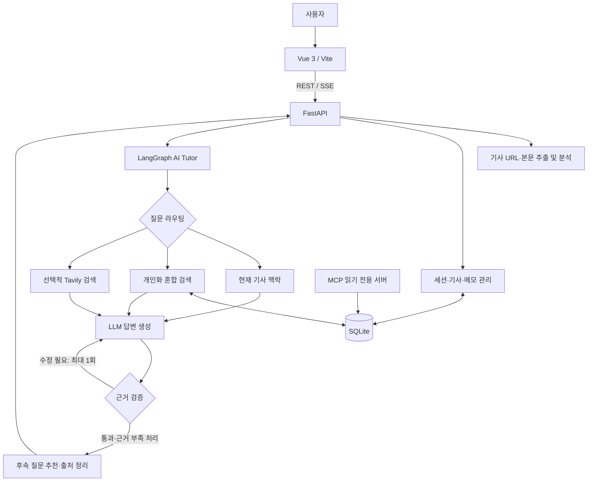

# PharmaMate 3.0

> **제약·바이오 기사를 읽고, 이해하고, 질문하며, 학습 기록으로 축적하는 개인화 AI 학습 Agent**

PharmaMate는 제약·바이오 분야 입문자가 뉴스 기사에 등장하는 전문 용어와 산업 이슈를 이해하도록 돕는 학습 서비스입니다. 기사 URL 또는 본문을 입력하면 핵심 내용을 정리하고, 기사 맥락에 맞는 용어 설명과 AI Tutor 질의응답을 제공합니다. 학습한 내용은 저장·검색·복습할 수 있으며, 이전 학습 이력과 직전 대화를 반영한 후속 질문을 추천합니다.

**학습 흐름:** 기사 입력 → 기사 브리핑·용어 탐색 → AI Tutor 질문 → 후속 질문으로 심화 학습 → 학습 메모 저장·복습

- **기준선:** PharmaMate 2.2 (`PharmaMate_2_0.ipynb`, Jupyter Notebook + Gradio)
- **현재 구현:** PharmaMate 3.0 (Vue 3 + FastAPI + LangGraph + SQLite)
- **과제 유형:** 신규 AI Agent 개발(2번). (기존 자체 프로젝트 2.2를 개선 전 기준선으로 활용)

## 1. 프로젝트명 및 주제 선정 배경

### 프로젝트명

**PharmaMate — 제약·바이오 기사 기반 개인화 AI 학습 Agent**

### 주제 선정 배경

제약·바이오 기사에는 임상시험 단계, 약물 작용기전, 허가 절차, 기업의 개발 전략처럼 사전 지식이 필요한 개념이 빈번하게 등장합니다. 기사를 읽다가 전문 용어를 따로 검색하고, 다시 기사로 돌아와 맥락을 연결해야 하는 과정은 입문자에게 부담이 됩니다.

PharmaMate는 이러한 학습 과정을 하나의 서비스 안에 통합하기 위해 시작했습니다. 초기 2.2 버전에서는 Gradio 기반 기사 분석·질의응답·SQLite 학습 기록을 구현했고, 3.0에서는 **개인화 검색, 근거 검증, 동적 질문 추천, 웹 서비스 구조, 세션 복원**을 강화했습니다.

## 2. 해결하고자 하는 문제

- **기사 이해의 높은 진입 장벽:** 제약·바이오 기사에는 임상시험, 신약 개발, 약물 작용기전, 규제·허가 등 전문 용어와 배경지식이 빈번하게 등장합니다. 입문자는 핵심 내용과 산업적 의미를 파악하기 어렵습니다.
- **용어와 기사 맥락의 단절:** 모르는 용어를 별도로 검색하는 과정에서 기사 읽기의 흐름이 끊기고, 일반적인 정의를 찾아도 해당 용어가 _이 기사에서_ 왜 중요한지 이해하기 어렵습니다.
- **개인별 학습 수준과 후속 학습 방향의 차이:** 사용자마다 배경지식과 궁금한 내용이 다르지만 일률적인 요약은 이를 반영하기 어렵습니다. 기사 이해 이후 무엇을 더 질문하고 어떤 개념으로 확장해야 할지도 판단하기 어렵습니다.
- **과거 학습과 새로운 정보의 단절:** 이전에 공부한 약물·기술·임상 개념이 새로운 기사에 등장해도 기존 학습 내용과 연결하기 어려워 같은 내용을 반복해서 검색하거나 학습하게 됩니다.
- **학습 이력 관리와 복습의 어려움:** 읽은 기사, 학습한 용어, 질문과 답변, 개인 메모가 분산되면 학습 내용을 체계적으로 확인하고 복습하기 어렵습니다. 지식이 누적되기보다 일회성 정보 소비로 끝나기 쉽습니다.
- **개별 기사 중심의 단편적인 산업 이해:** 동일한 기업·신약·임상시험에 관한 후속 보도가 이어져도 기사 간 관계를 직접 정리해야 하므로 개별 사건을 산업 이슈의 흐름으로 연결해 이해하기 어렵습니다.

PharmaMate는 이러한 문제를 해결하기 위해 **기사 이해 → 맥락 기반 질의응답 → 후속 학습 → 학습 기록 축적·복습**을 하나의 서비스로 연결하고, 사용자가 제약·바이오 지식을 지속적으로 쌓을 수 있는 개인화 학습 환경을 제공하고자 합니다.

## 3. 개발 환경 및 기술 스택

PharmaMate는 **Vue 3 기반 프런트엔드와 FastAPI 기반 백엔드**를 중심으로 구성되며, LangGraph를 활용해 AI Agent의 질문 처리 흐름을 관리합니다. 사용자 학습 데이터는 SQLite에 저장하고, OpenAI 모델을 활용해 기사 분석, 질의응답 및 개인화된 학습을 지원하고 있습니다.

| 영역           | 사용 기술                     | 역할                                                     |
| -------------- | ----------------------------- | -------------------------------------------------------- |
| 개발 언어      | Python 3.11, JavaScript       | 백엔드 AI 로직 및 프런트엔드 구현                        |
| 프런트엔드     | Vue 3, Vite 6                 | 기사 분석, AI Tutor, 학습 기록 등 사용자 인터페이스 구현 |
| 백엔드 API     | FastAPI, Pydantic, Uvicorn    | REST API 제공, 요청·응답 데이터 검증 및 SSE 스트리밍     |
| AI Agent       | LangGraph, LangChain          | 질문 라우팅, 학습 기록 검색, 답변 생성 및 검증 흐름 관리 |
| LLM            | OpenAI GPT-4o-mini            | 기사 요약, 핵심 용어 분석, 질의응답 및 답변 검증         |
| 임베딩         | OpenAI text-embedding-3-small | 학습 기록의 의미 기반 검색을 위한 벡터 생성              |
| 데이터베이스   | SQLite                        | 사용자 세션, 학습 용어, Q&A 및 기사 학습 기록 저장       |
| 외부 정보 검색 | Tavily API                    | 최신 제약·바이오 정보 검색 및 답변 근거 확보             |
| 도구 연동      | MCP (Model Context Protocol)  | 외부 도구와 AI Agent 간 연동 인터페이스 제공             |
| 실시간 응답    | Server-Sent Events (SSE)      | AI Agent의 처리 단계 및 검증 완료된 답변을 실시간 전달   |
| 컨테이너 실행  | Docker, Docker Compose        | 웹 화면·API 실행 및 SQLite 데이터 볼륨 보존              |

### 기술 구성의 특징

- **프런트엔드와 백엔드 분리:** Vue와 FastAPI를 통해 사용자 인터페이스와 AI 처리 로직의 역할을 구분하고, REST API로 연결한다.
- **LangGraph 기반 Agent:** 질문의 특성에 따라 기사 맥락, 개인 학습 기록, 외부 웹 검색을 활용하는 처리 흐름을 구성한다.
- **SQLite 기반 개인화 학습:** 별도의 데이터베이스 서버 없이 학습 이력을 저장하며, 키워드 검색과 임베딩 유사도 검색을 결합해 과거 학습 내용을 재활용한다.
- **근거 기반 답변 검증:** 생성된 답변을 검증한 뒤 사용자에게 전달하여, 근거가 부족한 정보의 무분별한 제공을 줄인다.
- **SSE 기반 진행 상태 전달:** 질문 처리 단계와 최종 답변을 순차적으로 전달하여 사용자가 AI Agent의 진행 상황을 확인할 수 있도록 한다.

기술 선택의 세부 근거는 [`docs/adr/`](docs/adr/)에서 확인할 수 있습니다.

## 4. 시스템 아키텍처



### 핵심 처리 흐름

1. **기사 수집·정제:** URL 또는 붙여넣은 본문을 입력받아 기사 제목·부제목·본문을 분리하고 가능한 경우 캡션·관련 기사 등 주변 요소를 제거합니다.
2. **학습 컨텍스트 구성:** 기사 분석 결과와 선택 용어, 최근 대화, 저장된 학습 기록을 결합합니다.
3. **질문 라우팅:** LangGraph가 기사 문맥, 개인 기록, 최신 웹 검색 중 필요한 근거 경로를 선택합니다.
4. **검색 증강 답변:** 개인 기록은 임베딩·단어 혼합 검색으로 찾고 원본 기록 ID와 함께 답변 근거로 전달합니다.
5. **근거 검증:** Validator가 수치·날짜·임상 결과 등 주요 주장의 근거를 검사합니다. 필요하면 **최대 1회** 재작성하고, 여전히 확인할 수 없으면 근거 부족을 표시합니다.
6. **사용자 응답:** FastAPI가 SSE로 진행 상태·검증 완료 답변·출처·후속 질문을 전달합니다. **모델이 생성하는 토큰을 검증 전에 그대로 실시간 공개하는 구조는 아닙니다.**
7. **학습 저장:** 사용자 검토 후 메모·Q&A를 SQLite에 저장하고 세션 재방문 시 복원합니다.

### 프로젝트 폴더 구조

```text
skala-ai-service-pharmamate/
├── frontend/                         # Vue 3 + Vite 프런트엔드
│   ├── src/                           # 화면·컴포넌트·API 연동 코드
│   ├── package.json                   # 프런트엔드 의존성·실행 명령
│   ├── Dockerfile                     # Vue 프로덕션 빌드와 Nginx 이미지
│   └── nginx.conf                     # /api·SSE 프록시 설정
├── backend/
│   ├── app/
│   │   ├── main.py                   # FastAPI 라우트·REST/SSE 진입점
│   │   ├── mcp_server.py             # 읽기 전용 MCP 서버 진입점
│   │   ├── api/                       # SSE 이벤트 등 API 보조 로직
│   │   ├── agents/                    # LangGraph 라우팅·답변·Validator
│   │   ├── services/                  # 기사 추출·분석·추천·세션 처리
│   │   ├── retrieval/                 # 임베딩·개인화 혼합 검색
│   │   ├── db/                        # SQLite 스키마·데이터 접근
│   │   ├── schemas/                   # 요청·응답 및 기사 데이터 모델
│   │   └── core/                      # 환경 설정·런타임 초기화
│   ├── tests/                         # 단위·통합·회귀 테스트
│   └── Dockerfile                     # FastAPI 런타임 이미지
├── eval/                              # 평가 사례·Before/After 비교 스크립트
├── docs/
│   ├── adr/                           # 기술 선택과 보류 사유(ADR)
│   └── experiments/                   # 기능별 실험 조건·측정 결과
├── compose.yaml                       # Vue·FastAPI·SQLite 볼륨 실행
├── requirements-api.txt               # 3.0 API 런타임 패키지
├── .env.example                       # 환경 변수 예시
├── PharmaMate_2_0.ipynb              # PharmaMate 2.2 비교 기준선
├── requirements.txt                   # Python 패키지 의존성
└── README.md                          # 프로젝트 소개·구조·API·실험 결과
```

**계층별 책임:** `frontend`는 사용자 인터페이스, `main.py`는 API 및 세션 접근 제어, `services`는 기사·학습 도메인 로직, `agents`는 질문 처리 흐름, `retrieval`은 관련 기록 검색, `db`는 영속 저장을 담당합니다. 코드는 모듈로 나누되 백엔드는 **하나의 FastAPI 프로세스**로 실행하는 모듈형 모놀리스 구조입니다.

## 5. 주요 구현 기능

### 5.1 기사 입력·분석 및 브리핑

- 기사 URL 또는 본문을 입력하여 제목·부제목·본문을 분석합니다.
- 핵심 내용을 한 줄로 정리하고 기사 유형·산업 이슈·주요 용어를 표시합니다.
- 본문에 포함되지 않아야 할 이미지 캡션, 관련 기사, 페이지 메뉴 등을 가능한 범위에서 필터링합니다.
- 추출이 불가능한 매체는 본문 직접 입력 방식으로 대체할 수 있습니다.

### 5.2 전문 용어 중심 AI Tutor

- 기사에 등장한 핵심 용어를 탐색하고 초보자 눈높이의 설명을 제공합니다.
- 저장한 용어와 새로운 용어를 구분하고, 사용자가 용어를 추가·제외할 수 있습니다.
- 용어별 대화와 기사 전체에 대한 일반 질문을 지원합니다.
- 질문에 따라 기사·학습 기록·외부 검색 경로를 선택합니다.

### 5.3 개인화 RAG: 이전 학습과 현재 질문 연결

**왜 필요한가?** 사용자가 예전에 ADC를 학습했더라도 다음에 “항체에 약물을 붙이는 기술”처럼 다른 표현으로 질문하면 단어 일치만으로는 관련 기록을 찾지 못할 수 있습니다.

**구현 방식:** SQLite에 저장된 학습 메모·Q&A를 임베딩하고, 질문 임베딩의 코사인 유사도와 키워드 일치 점수를 결합해 검색합니다. 검색 결과에는 원본 기록 ID를 연결하고, 임베딩 호출에 실패하면 단어 검색으로 복구합니다. SQLite는 원본 저장소이자 재구축 가능한 파생 인덱스 저장소입니다.

**확인된 결과:** 합성 기록 14개·질의 20개에서 Recall@3 `0.950 → 1.000`, MRR `0.925 → 0.942`. 반면 검색 지연 p50은 약 `0.160초`로 증가했습니다. 검색 성능 개선이 전체 답변 정확도 개선을 자동으로 뜻하지는 않습니다. 상세 내용은 [F2 실험](docs/experiments/F2_personalized_rag.md)을 참고하세요.

### 5.4 답변 근거 검증(Validator)

**왜 필요한가?** 기사에 시험 목적만 나와 있는데 AI가 이를 시험에서 효과가 입증된 결과처럼 표현하거나, 출처에 없는 임상 수치·날짜를 단정할 수 있기 때문입니다.

**구현 방식:** 답변과 근거를 함께 검사하여 `pass`, `revise`, `insufficient_evidence`로 판정합니다. 수치·날짜·임상 결과 미보고 상황에는 규칙 기반 보호도 적용합니다. 재작성은 최대 1회로 제한하며, Validator 장애를 검증 통과로 처리하지 않습니다.

**확인된 결과:** 합성 판정 13건에서 기대 분류 13/13 일치. 한 비교 사례에서는 잘못된 초기 답변을 재작성해 시험 목적과 미보고 결과를 구분했지만, 응답 시간은 `3.19초 → 6.15초`로 증가했습니다. 이는 작은 합성 평가셋의 결과이며 실제 기사 전체의 무오류를 보증하지 않습니다. [F3 실험](docs/experiments/F3_answer_validation.md).

### 5.5 대화 맥락 기반 후속 질문 추천

사용자가 “ADC는 왜 항체를 사용해?”라고 질문하면, 답변 이후 **표적 항원**, **일반 항암제와의 차이**, **부작용·한계**처럼 서로 다른 학습 방향의 질문을 제안합니다. 현재 용어·직전 질문·답변·학습 이력을 활용하고, 추천 질문에는 학습 목적을 연결합니다. 단순히 동일 용어의 정의 질문을 반복하지 않도록 설계했습니다. 구현·비교 기록은 [F5 실험](docs/experiments/F5_dynamic_followup_questions.md)에 있습니다.

### 5.6 학습 메모·세션 복원

- AI Tutor 대화를 바탕으로 학습 메모 초안을 만들고 **사용자가 검토·수정한 뒤** 저장합니다.
- 저장한 용어, 기사, Q&A, 메모를 다시 조회할 수 있습니다.
- 익명 세션 토큰과 SQLite를 사용하여 기사·대화·메모를 브라우저 재접속 시 복원합니다.
- 서버 프로세스 재시작 후 동일 SQLite 파일을 열어 복원하는 테스트를 수행했습니다.
- 기록 검색과 API 접근에는 세션 소유 범위를 적용합니다.

**한계:** 익명 세션 토큰은 공개 서비스용 계정 인증을 대체하지 않습니다. [F7.1 실험](docs/experiments/F7_1_sessions.md).

### 5.7 기사 중복 판정과 산업 이슈 묶음

동일 기사 재등록과 **서로 다른 기사가 같은 사건을 다루는 상황**을 구분합니다. URL·본문·제목 기반 중복 판정을 사용하고, 같은 산업 이슈의 서로 다른 기사는 삭제하지 않고 연결합니다. 동일 약물이라도 임상 2상 결과와 3상 결과처럼 별개 사건은 무조건 합치지 않도록 주의합니다. 자동 연결과 수동 연결을 함께 제공하며, 관련 실험은 [F7.2 기록](docs/experiments/F7_2_article_issue_management.md)에 있습니다.

### 5.8 Vue UI·FastAPI·SSE·오류 복구

- Vue 화면을 기사 읽기, AI Tutor, 학습 기록 흐름으로 구성했습니다.
- FastAPI가 기사 분석·채팅·세션·기록 API를 제공하며 API 키는 서버에서 관리합니다.
- SSE 이벤트로 **진행 상태, 검증 완료 답변, 출처, 추천 질문, 완료·오류**를 전달합니다.
- 연결 취소·유휴 시간 초과·완료 이벤트 누락 시 대기 상태가 지속되지 않도록 복구합니다.
- URL 추출 실패·외부 검색 장애·임베딩 실패 등에서 대체 경로나 오류 안내를 제공합니다.

**기술적 선택:** 검증 전 답변을 그대로 스트리밍하면 이후 Validator가 내용을 뒤집을 수 있으므로, **상태는 먼저 표시하고 검증된 답변을 이후 분할 전송**합니다. 이는 신뢰성을 우선한 선택이며 첫 글자 출력 지연의 대가가 있습니다. [F6.2 SSE](docs/experiments/F6_2_sse_streaming.md), [F6.4 브라우저 E2E](docs/experiments/F6_4_browser_e2e.md).

### 5.9 MCP 및 선택적 오케스트레이션 기술

- **MCP:** 별도 호스트에서 현재 세션의 학습 기록·읽은 기사를 조회할 수 있는 읽기 전용 Tool/Resource/Prompt 인터페이스를 제공합니다. 주목적은 답변 품질 향상이 아니라 도구 연동 표준화·재사용성입니다.
- **Query Routing:** 기존 2.2 라우터를 개선하고 합성 질문 24개로 평가한 뒤 개선안을 채택했습니다.
- **병렬 실행:** 독립적인 메모·웹 근거 수집을 병렬로 처리하는 방식을 도입했습니다. 실제 이점은 환경과 도구 응답 시간에 따라 달라집니다.
- **Dynamic Planning:** 복합 질문용 별도 계획 단계는 추가 모델 호출의 비용 대비 품질 이점이 충분하지 않아 보류했습니다.
- **Ollama:** 로컬 모델의 구조화 출력 호환성을 검토했으나 라우팅 정확도·지연을 고려해 기본 모델 교체를 보류했습니다.

선택 기술의 도입 여부는 기능별 실험 기록과 ADR을 근거로 판단합니다.

### 5.10 API Endpoint 명세

FastAPI 엔드포인트는 `backend/app/main.py`에 선언되어 있습니다.

| Method | Endpoint                                        | 기능                               | 응답 방식 |
| ------ | ----------------------------------------------- | ---------------------------------- | --------- |
| `GET`  | `/api/health`                                   | 서버 상태 확인                     | JSON      |
| `POST` | `/api/sessions`                                 | 익명 학습 세션 및 접근 토큰 생성   | JSON      |
| `GET`  | `/api/sessions/{session_id}`                    | 세션의 기사·선택 용어·대화 복원    | JSON      |
| `PUT`  | `/api/sessions/{session_id}/article`            | 현재 학습 기사·선택 용어 저장      | JSON      |
| `POST` | `/api/articles/analyze`                         | 기사 URL 또는 입력 본문 분석       | JSON      |
| `POST` | `/api/articles/classify-term`                   | 사용자가 추가한 용어 분류          | JSON      |
| `POST` | `/api/chat`                                     | 비스트리밍 AI Tutor 질의응답       | JSON      |
| `POST` | `/api/chat/stream`                              | AI Tutor 진행 상태·검증 답변 전달  | SSE       |
| `POST` | `/api/sessions/{session_id}/chat/stream`        | 세션 기록과 연계한 AI Tutor 대화   | SSE       |
| `GET`  | `/api/study-records`                            | 학습 기록 목록 조회(기존 호환 API) | JSON      |
| `POST` | `/api/study-records`                            | 학습 기록 저장(기존 호환 API)      | JSON      |
| `GET`  | `/api/sessions/{session_id}/study-records`      | 해당 세션의 학습 기록 조회         | JSON      |
| `POST` | `/api/sessions/{session_id}/study-records`      | 해당 세션에 학습 메모 저장         | JSON      |
| `POST` | `/api/sessions/{session_id}/articles/mark-read` | 읽은 기사 등록 및 중복·이슈 판정   | JSON      |
| `GET`  | `/api/sessions/{session_id}/articles`           | 세션에서 읽은 기사 목록            | JSON      |
| `GET`  | `/api/sessions/{session_id}/industry-issues`    | 세션별 산업 이슈 묶음 조회         | JSON      |

**인증·세션:** `/api/sessions`에서 발급받은 접근 토큰을 세션 전용 API 요청의 `Authorization` 헤더에 전달합니다. 잘못되거나 없는 세션 접근 권한은 동일한 `404` 응답으로 처리하여 세션 존재 여부 노출을 줄입니다. 익명 토큰은 정식 사용자 인증을 대체하지 않습니다.

**SSE 이벤트:** `status`(진행 단계) → `token`(검증된 답변 조각) → `sources`(참고 근거) → `recommendations`(후속 질문) → `done`(완료) 순서로 전송하며, 실패 시 `error`를 전송합니다. `token`은 **Validator 검증 후** 제공되므로 모델의 미검증 초안이 노출되지 않습니다.

**요청·응답 스키마:** 정확한 필드와 타입은 서버 실행 후 [Swagger UI](http://127.0.0.1:8000/docs) 또는 [OpenAPI JSON](http://127.0.0.1:8000/openapi.json)에서 확인할 수 있습니다. MCP는 위 HTTP API와 별도의 서버 진입점으로 제공됩니다.

## 6. 프로그램 실행 방법

### 6.1 사전 준비

- Python **3.11 이상**, Node.js **20 이상**
- Docker Engine 및 Docker Compose 플러그인 (컨테이너 실행을 선택하는 경우)
- OpenAI API 키(필수), Tavily API 키(선택)
- 프로젝트 루트에서 실행

```bash
cd skala-ai-service-pharmamate
python3.11 -m venv pharma
source pharma/bin/activate
python -m pip install -r requirements.txt
npm ci --prefix frontend
```

Windows PowerShell에서는 `py -3.11 -m venv pharma` 및 `.\pharma\Scripts\Activate.ps1`을 사용합니다.

### 6.2 환경 변수

루트 디렉터리에 Git으로 추적하지 않는 `.env` 파일을 작성합니다. `.env.example`을 복사해 API 키를 입력해도 됩니다.

```dotenv
OPENAI_API_KEY=발급받은_API_키
# TAVILY_API_KEY=선택_입력
PHARMAMATE_MODEL=gpt-4o-mini
PHARMAMATE_EMBEDDING_MODEL=text-embedding-3-small
# PHARMAMATE_DATA_DIR=/원하는/저장/경로
```

기본 DB 경로는 `pharmamate_data/pharmamate.sqlite3`입니다. 실제 API 호출에는 제공자 요금이 발생할 수 있습니다. `.env`, 로컬 DB, 개인 학습 기록, `eval/results/`의 생성 로그는 저장소에 커밋하지 마세요.

### 6.3 Docker Compose 실행

Docker Engine이 실행 중인지 확인한 뒤 프로젝트 루트에서 진행합니다. `.env`가 없을 때 예시 파일을 복사하고 `OPENAI_API_KEY`에 실제 키를 입력합니다. 기존 `.env`가 있으면 그대로 사용합니다.

```bash
cp -n .env.example .env
docker compose up --build -d
docker compose ps
```

- 웹 화면: http://127.0.0.1:8080
- API 상태: http://127.0.0.1:8000/api/health
- API 명세: http://127.0.0.1:8000/docs
- 로그 확인: `docker compose logs -f api web`
- 종료: `docker compose down`

SQLite 학습 데이터는 `pharmamate_data` Docker 볼륨에 저장되어 컨테이너를 내려도 유지됩니다. 데이터까지 초기화하려면 `docker compose down --volumes`를 실행합니다. Compose 포트는 `.env`의 `PHARMAMATE_WEB_PORT`, `PHARMAMATE_API_PORT`로 바꿀 수 있습니다.

Compose는 API 컨테이너가 정상 상태가 된 뒤 웹 컨테이너를 시작합니다. Nginx는 `/api` 요청을 FastAPI로 전달하고, SSE 응답을 중간에 모으지 않도록 설정되어 있습니다.

### 6.4 백엔드 직접 실행

```bash
source pharma/bin/activate
python -m uvicorn backend.app.main:app --host 127.0.0.1 --port 8000
```

### 6.5 프런트엔드 직접 실행 (별도 터미널)

```bash
npm run dev --prefix frontend
```

- 웹 화면: http://127.0.0.1:5173
- API 상태: http://127.0.0.1:8000/api/health
- API 명세: http://127.0.0.1:8000/docs

## 7. 테스트 결과 및 실행 화면

기존 README에 기록된 **2026-10-21 로컬 검증 결과**입니다. 아래 수치는 이 문서 작성 과정에서 새로 실행한 결과가 아닙니다.

| 확인 항목          | 실행명령/조건                                                  | 결과                                                        |
| ------------------ | -------------------------------------------------------------- | ----------------------------------------------------------- |
| 백엔드 회귀 테스트 | `./pharma/bin/python -m unittest discover -s backend/tests -q` | **81개 통과**                                               |
| Vue 프로덕션 빌드  | `npm run build --prefix frontend`                              | **성공** (Vite 6.4.4)                                       |
| 초기 화면          | 격리된 로컬 세션의 Chrome 화면 캡처                            | 기사 입력·단계 이동 화면 표시 (**LLM 품질 검증 아님**)      |
| 브라우저 E2E       | 합성 API 기반 세션·SSE·오류 복구 시나리오                      | [F6.4 실험 기록](docs/experiments/F6_4_browser_e2e.md) 참조 |


브라우저 실험: [F6.4 브라우저 E2E](docs/experiments/F6_4_browser_e2e.md). 개별 기능 기록: [`docs/experiments/`](docs/experiments/).

직접 답변을 비교하려면 합성 사례를 먼저 확인한 뒤, API 키를 설정해 같은 입력의 2.2 기준선과 3.0을 실행할 수 있습니다. 실제 모델 비교에는 API 요금이 발생하고 결과 파일은 `eval/results/`에 생성되며 Git에서 제외됩니다.

```bash
python eval/compare_answers.py --case-id RAG-01 --demo
python eval/compare_answers.py --all --baseline-ref 9814fc2
```

## 8. 기존 프로젝트 Before / After 비교 및 검증

### 8.1 기능·구조 비교

| 구분           | Before: PharmaMate 2.2       | After: PharmaMate 3.0                                     | 검증 근거         |
| -------------- | ---------------------------- | --------------------------------------------------------- | ----------------- |
| UI             | Jupyter Notebook 내부 Gradio | Vue 기사 읽기·AI Tutor·학습 기록                          | 빌드·브라우저 E2E |
| 백엔드         | 노트북 중심 코드             | FastAPI + 기능별 Python 모듈                              | API·회귀 테스트   |
| 질문 라우팅    | 기존 LangGraph Router        | 질문 유형에 맞춘 라우팅 개선                              | F8 실험 기록      |
| 개인 기록 검색 | SQLite 단어 일치 중심        | 임베딩·단어 혼합 검색 + 실패 시 단어 검색                 | F2 검색 평가      |
| 답변 검증      | 별도 Validator 없음          | 근거 판정·최대 1회 재작성                                 | F3 판정 평가      |
| 추천 질문      | 선택 용어 기반               | 직전 Q&A·학습 맥락 기반                                   | F5 실험           |
| 상태·기록      | Gradio 상태 + 로컬 SQLite    | 세션 토큰 + SQLite 재접속·재시작 복원                     | F7.1 실험         |
| 기사 중복      | URL·정규화 제목 기반 방지    | 기사 중복 판정 + 산업 이슈 그룹화                         | F7.2 실험         |
| 사용자 응답    | Gradio 응답                  | REST/SSE 진행 상태·검증 답변                              | F6.2·F6.4 실험    |
| 도구 연동      | MCP Python 서버              | 학습 기록·읽은 기사에 대한 읽기 전용 표준 인터페이스 제공 |

### 8.2 측정된 결과

| 실험                     | 조건                      |              Before |       After | 해석                             |
| ------------------------ | ------------------------- | ------------------: | ----------: | -------------------------------- |
| RAG Recall@3             | 합성 메모 14개, 질의 20개 |               0.950 |   **1.000** | 상위 3개 검색 재현율 개선        |
| RAG MRR                  | 동일 평가셋               |               0.925 |   **0.942** | 관련 기록 순위 개선              |
| RAG 검색 지연 p50        | 동일 평가셋               |           0.000초\* | **0.160초** | 의미 검색에 추가 지연 발생       |
| Validator 기대 분류 일치 | 합성 답변 13건            | 별도 Validator 없음 |   **13/13** | 작은 평가셋에서 기대 판정과 일치 |
| 근거 없는 답변 통과      | 합성 근거 이탈 답변 6건   |      별도 측정 없음 |     **0/6** | 평가셋 내 잘못된 통과 없음       |
| Validator 답변 비교 지연 | 임상 관련 합성 질문 1건   |              3.19초 |  **6.15초** | 재작성으로 지연 증가             |

\* 2.2 단어 검색 지연의 `0.000초` 표기는 작은 fixture에서 측정 분해능보다 짧았다는 의미이지 실제 지연이 0이라는 뜻은 아닙니다.

**평가 설계:** 비교 대상의 변경 요소를 명시하고, 같은 합성 데이터·질문과 가능한 한 같은 모델·설정을 사용했습니다. RAG는 검색 지표(Recall@3, MRR)와 지연을, Validator는 근거 판정 결과와 응답 지연을 함께 기록했습니다. 실제 사용자 데이터·장기간 운영·대규모 기사에 대한 검증은 수행하지 않았습니다. 토큰·비용이 제공되지 않은 실행은 **미측정**으로 취급합니다.

**해석상의 주의:** 검색 Recall@3 개선은 최종 답변 정확도 개선과 같지 않습니다. Validator 13/13은 모든 종류의 환각을 방지한다는 의미가 아닙니다. 실제 답변 지연 비교는 단일 사례이므로 통계적 평균으로 해석할 수 없습니다.

**근거 문서:** [F2 개인화 RAG](docs/experiments/F2_personalized_rag.md), [F3 근거 검증](docs/experiments/F3_answer_validation.md). 추가 실험과 선택 기술 비교는 [`docs/experiments/`](docs/experiments/)에 있습니다.

### 8.3 기술 채택·보류의 판단 기준

- **채택:** 기능이 정상 동작하고, 목표 지표·사용성·연동 가치가 추가 지연·비용·운영 복잡도보다 유의미한 경우
- **보류:** 복잡도 또는 모델 호출 비용이 증가했으나 측정된 이점이 충분하지 않은 경우
- **구분:** MCP는 주로 표준 인터페이스와 재사용성, 병렬 실행은 지연, Validator는 근거성, RAG는 검색 품질을 각각 검증해야 함
- **모델 공정성:** Ollama와 OpenAI처럼 **모델 자체가 다른 비교**를 시스템 구조 개선 효과로 해석하지 않음

## 9. 개발 과정에서의 문제점 및 해결 방법

| 개발 중 문제                                     | 원인·관찰                                       | 해결 방법                                                      | 확인 방법·트레이드오프                                                                                                                                 |
| ------------------------------------------------ | ----------------------------------------------- | -------------------------------------------------------------- | ------------------------------------------------------------------------------------------------------------------------------------------------------ |
| 기사 본문에 부제목·캡션·주변 텍스트 혼입         | 매체별 HTML 구조와 본문 선택 규칙 차이          | 실제 문단 컨테이너 우선 추출, 부제목 별도 저장, 주변 요소 제외 | [본문 경계](docs/experiments/F9_17_article_body_boundary.md), [부제목](docs/experiments/F9_15_article_subtitle_separation.md) 사례; 사이트 변경에 취약 |
| 일반 개념 설명까지 근거 부족으로 거부            | 임상 결과 검증 규칙을 일반 정의에 과도하게 적용 | 질문·주장 유형 분리, 안정적인 일반 개념은 제한적으로 허용      | [Tutor 근거 보강](docs/experiments/F9_18_tutor_evidence_recovery.md); 오판 가능성 잔존                                                                 |
| 시험 목적을 실제 효능 결과처럼 서술              | 생성 답변이 근거 범위를 초과                    | 결과 미보고 규칙·Validator 재작성                              | [F3](docs/experiments/F3_answer_validation.md); 지연·비용 증가                                                                                         |
| 의미 검색이 관련성 낮은 출처도 함께 반환         | top-k 후보를 그대로 표시                        | 원본 기록 연결 및 검색 결과 점검; 임계값·재순위화는 향후 검토  | [F2](docs/experiments/F2_personalized_rag.md); 출처 과다 노출 가능                                                                                     |
| SSE 연결 종료 후 UI가 대기 상태에 머묾           | 완료 이벤트 누락·연결 취소·유휴 상태            | 종료 검사·취소 처리·유휴 시간 제한·오류 표시                   | [F6.4](docs/experiments/F6_4_browser_e2e.md); 실제 네트워크 다양성은 추가 검증 필요                                                                    |
| 프로세스 재시작 시 학습 연속성 필요              | 메모리 상태만으로 복원 불가                     | SQLite 세션·대화·기사 영속화 및 세션 접근 제어                 | [F7.1](docs/experiments/F7_1_sessions.md); 익명 토큰은 인증 대체 불가                                                                                  |
| 추가 계획·로컬 모델 도입의 비용 대비 효과 불확실 | 추가 LLM 호출과 로컬 모델 응답 지연·라우팅 차이 | Dynamic Planning·Ollama 기본 채택 보류                         | 선택 기술 실험·ADR; 환경이 바뀌면 재평가 가능                                                                                                          |

## 10. 한계점 및 향후 개선 방향

### 현재 한계

1. **기사 추출 범위:** 언론사별 HTML 변경, 유료·로그인 기사, JavaScript 동적 로딩에 따라 본문 추출이 실패하거나 부정확할 수 있습니다.
2. **근거의 신뢰성:** Validator는 제공된 근거와 답변의 일치 여부를 돕지만 출처 자체의 사실성, 모든 누락·오판을 보증하지 않습니다. 특정 임상시험의 실제 결과가 확인되지 않으면 확정 답변을 할 수 없습니다.
3. **평가 일반화:** 검색 14개 기록·20개 질의, Validator 13건 등 **소규모 합성 사례** 중심입니다. 실제 사용자 학습 효과와 장기 유지율은 미측정입니다.
4. **성능·비용:** 의미 검색의 임베딩 호출과 Validator 재작성은 지연·API 비용을 증가시킵니다. SSE는 검증 전 원시 토큰을 표시하지 않아 첫 본문 출력이 늦을 수 있습니다.
5. **운영·보안:** 로컬 SQLite와 익명 세션 토큰은 공개 다중 사용자 환경의 인증·동시성·백업·관측 요구사항을 충족하지 않습니다. 학습 메모를 외부 임베딩 API로 보내는 데이터 처리도 고려해야 합니다.
6. **도메인 종속성:** 제약·바이오 용어 규칙과 프롬프트가 코드에 남아 있어 분야만 바꾸면 즉시 동작하는 범용 Agent는 아닙니다.

### 향후 개선 방향

**장기 목표는 PharmaMate를 ‘분야별 기사 학습 Agent’의 재사용 가능한 템플릿으로 확장하는 것**입니다. 기사 추출·세션·검색·SSE·학습 메모·근거 검증은 공통 엔진으로 유지하고, 분야별 규칙은 도메인 프로필로 분리합니다.

| 도메인 프로필    | 제약·바이오 예시         | 타 분야 확장 시 변경 항목    |
| ---------------- | ------------------------ | ---------------------------- |
| 기사 분류·브리핑 | 임상·허가·기업 이슈      | 분야별 사건·기사 유형        |
| 용어 체계        | 신약·임상시험·규제       | 전문 용어 분류·제외 규칙     |
| Tutor 설명 원칙  | 기전·시험 설계·근거 구분 | 분야별 설명 수준·주의할 주장 |
| 신뢰 출처        | 규제기관·임상 등록 자료  | 분야별 공식 근거와 검색 범위 |
| 평가 데이터      | 제약 기사·질문·기대 근거 | 분야별 검증 질문·정답 출처   |

이 외에도 **실제 사용자 기반 검색·답변 평가셋 확대**, 검색 출처 재순위화, 기사별 추출 규칙 유지관리, 사용자 인증·DB 운영 개선, API 지연·비용 계측, 추천 질문의 학습 효과 평가가 필요합니다. 반도체·경제 등 타 분야로 확장할 때는 프로필 분리만으로 완료 처리하지 않고, 새 분야의 기사 추출·용어 분석·근거 검증을 별도로 회귀 테스트해야 합니다.

---

### 설계 결정 및 실험 자료

- [ADR — 기술 선택 배경, 대안, 결정, 영향](docs/adr/)
- [실험 기록 — 조건, 지표, 결과, 한계](docs/experiments/)
- [PharmaMate 2.2 비교 기준선](PharmaMate_2_0.ipynb)
