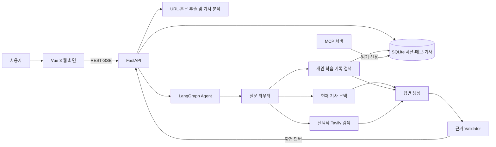

# PharmaMate 3.0

제약·바이오 기사를 **읽기 → 질문하기 → 학습 기록으로 남기기** 순서로 공부하는 AI Agent 서비스입니다. 사용자는 Vue 웹 화면에서 기사를 분석하고, 어려운 용어를 고른 뒤 AI Tutor와 대화할 수 있습니다. 기존 PharmaMate 2.2의 노트북·Gradio 구현을 비교 기준으로 삼아 웹 서비스 구조와 학습 기능을 발전시켰습니다.

## 1. 프로젝트명 및 주제 선정 배경

**프로젝트명:** PharmaMate 3.0 — 제약·바이오 기사 학습 AI Agent

**과제 유형:** 신규 AI Agent 개발(2번), 기존 PharmaMate 2.2를 개선 전 기준으로 활용

제약·바이오 뉴스에는 임상 단계, 신약 기전, 규제 절차처럼 배경지식이 필요한 표현이 자주 등장합니다. 기사를 읽다가 모르는 용어를 따로 검색하고, 다시 기사로 돌아와 맥락을 연결하는 과정은 비전공자에게 부담이 됩니다. PharmaMate는 기사 원문과 개인 학습 기록을 한 화면의 학습 흐름으로 연결하기 위해 시작했습니다.

## 2. 해결하고자 하는 문제

- **본문과 주변 정보의 혼입:** 일부 언론사 페이지는 제목·부제목·이미지 캡션·공유 메뉴·관련 기사를 본문과 함께 추출합니다. 이 텍스트가 요약과 용어 분석에도 영향을 줍니다.
- **용어와 기사 맥락의 단절:** 정의만 보면 그 용어가 *이 기사에서* 왜 중요한지 이해하기 어렵습니다.
- **근거가 불명확한 답변:** 일반 개념, 기사에 적힌 사실, 특정 임상시험의 실제 결과를 구분하지 않으면 과도하게 단정하거나 답변을 지나치게 거부할 수 있습니다.
- **학습의 연속성 부족:** 기사별 질문과 메모가 이어지지 않으면 이전에 공부한 개념을 다시 활용하기 어렵습니다.

## 3. 개발 환경 및 기술 스택

| 영역 | 사용 기술 | 역할 |
| --- | --- | --- |
| 실행 환경 | Python 3.11+, Node.js 20+ | 백엔드와 프런트엔드 실행 |
| 프런트엔드 | Vue 3, Vite 6 | 기사 읽기·AI Tutor·학습 기록 화면 |
| API | FastAPI, Pydantic, Uvicorn | REST API, 세션 접근 제어, SSE 응답 |
| Agent | LangGraph, LangChain, OpenAI Chat 모델 | 질문 분기, 답변 생성, 근거 검증 |
| 기본 모델 | `gpt-4o-mini` | 기사 분석·용어 분류·Tutor 답변. `PHARMAMATE_MODEL`로 변경 가능 |
| 개인 학습 검색 | SQLite, OpenAI 임베딩(`text-embedding-3-small`) | 저장 메모의 의미·단어 혼합 검색 |
| 외부 검색 | Tavily(선택) | 최신 정보나 기사 밖 근거가 필요한 질문 검색 |
| 외부 연동 | MCP Python 서버 | 세션 학습 기록·읽은 기사 검색용 Tool, Resource, Prompt 제공 |
| 검증 | Python `unittest`, Vite 빌드, 합성 사례 평가 스크립트 | 회귀 테스트와 Before / After 비교 |

기본 구성은 **Vue 화면 + 하나의 FastAPI 프로세스 + 로컬 SQLite**입니다. Python 코드는 기능별 모듈로 분리되어 있지만 마이크로서비스로 배포하지는 않습니다. 기술 선택 근거는 [ADR 문서](docs/adr/ADR-001-vue-fastapi-modular-monolith.md)에 기록했습니다.

## 4. 시스템 아키텍처



라우터는 기사·개인 기록·웹 검색 중 필요한 경로를 고릅니다. 근거가 부족할 때는 추가 검색이나 확인된 부분만의 답변을 시도합니다. SSE는 **진행 상태를 먼저** 보내고, 답변 본문은 검증이 끝난 뒤 나누어 전달합니다. 따라서 화면의 첫 글자가 모델 생성 즉시 표시되는 방식은 아닙니다.

| 경로 | 내용 |
| --- | --- |
| `frontend/` | Vue 화면과 Vite 개발 서버 |
| `backend/app/services/` | 기사 추출·분석, 추천 질문, 세션 처리 |
| `backend/app/agents/` | LangGraph 질문 분기·답변·근거 검증 |
| `backend/app/retrieval/`, `backend/app/db/` | 학습 기록 검색과 SQLite 저장 |
| `backend/app/main.py`, `backend/app/mcp_server.py` | HTTP/SSE API와 별도 MCP 진입점 |
| `eval/`, `docs/experiments/`, `docs/adr/` | 비교 도구, 실험 기록, 설계 결정 |

## 5. 주요 구현 기능

1. **기사 읽기:** URL이나 붙여넣은 본문을 분석합니다. URL에서는 가능한 경우 `title`, `subtitle`, `body`를 분리하고, 캡션·기사 바깥 요소를 제외합니다. 본문 문단은 읽기 편하게 구분해 표시합니다.
2. **기사 브리핑과 용어:** 기사 유형·한 줄 정리·업계 이슈를 보여주고, 핵심 용어를 새 용어/저장한 용어로 구별합니다. 본문에서 용어를 선택해 설명으로 이동하거나 직접 용어를 추가·제외할 수 있습니다. 직접 추가한 용어도 기사 맥락에 따라 분류합니다.
3. **AI Tutor:** 선택한 용어의 빠른 정리를 읽고 질문합니다. 대화는 용어별로 구분되며, 최초 추천 질문과 답변을 반영한 후속 질문을 제공합니다. 일반 질문은 기사 전체 맥락을 참고할 수 있습니다.
4. **근거를 확인하는 답변:** 개인 기록 검색과 필요 시 웹 검색을 연결합니다. Validator가 근거를 점검하고, 기사 사실·일반 배경지식·확인되지 않은 시험 세부사항을 구분합니다. 참고 자료는 필요할 때 펼쳐 볼 수 있습니다.
5. **학습 기록:** 대화를 반영한 메모 초안을 만들고 사용자가 수정해 저장합니다. 저장한 용어는 분야별·최신순으로 보이며, 용어를 선택하면 메모와 접을 수 있는 Q&A가 나타납니다.
6. **세션과 기사 이슈:** 익명 세션의 기사·대화·메모를 로컬 SQLite에 저장하고 브라우저에서 복원합니다. 읽은 기사는 관련 산업 이슈로 묶어 볼 수 있습니다.
7. **MCP 연동:** 별도 MCP 호스트에서 현재 세션의 학습 기록과 읽은 기사를 검색할 수 있는 읽기 전용 도구를 제공합니다.

## 6. 프로그램 실행 방법

프로젝트 루트에서 실행합니다. **OpenAI API 키가 있어야 세션을 만들고 기사 분석·Tutor 기능을 사용할 수 있습니다.** Tavily 키는 외부 웹 검색을 사용하려는 경우에만 필요합니다.

### 6.1 Python 환경과 패키지

```bash
python3.11 -m venv pharma
source pharma/bin/activate
python -m pip install -r requirements.txt
npm ci --prefix frontend
```

Windows PowerShell에서는 `py -3.11 -m venv pharma`로 만든 뒤 `.\pharma\Scripts\Activate.ps1`을 실행합니다.

### 6.2 환경 변수

프로젝트 루트에 Git으로 추적하지 않는 `.env`를 만듭니다.

```dotenv
OPENAI_API_KEY=여기에_발급받은_키
# TAVILY_API_KEY=필요할_때_입력
PHARMAMATE_MODEL=gpt-4o-mini
PHARMAMATE_EMBEDDING_MODEL=text-embedding-3-small
# PHARMAMATE_DATA_DIR=/원하는/저장/경로
```

기본 저장 경로는 `pharmamate_data/pharmamate.sqlite3`입니다. 모델·임베딩·검색 API 호출에는 제공자 요금이 발생할 수 있습니다.

### 6.3 서버와 화면

첫 번째 터미널에서 백엔드를 실행합니다.

```bash
source pharma/bin/activate
python -m uvicorn backend.app.main:app --host 127.0.0.1 --port 8000
```

두 번째 터미널에서 Vue 개발 서버를 실행합니다.

```bash
npm run dev --prefix frontend
```

브라우저에서 [http://127.0.0.1:5173](http://127.0.0.1:5173)을 엽니다. Vite가 `/api` 요청을 `127.0.0.1:8000`으로 전달합니다. API 상태는 [http://127.0.0.1:8000/api/health](http://127.0.0.1:8000/api/health), API 명세는 [http://127.0.0.1:8000/docs](http://127.0.0.1:8000/docs)에서 확인할 수 있습니다.

`PharmaMate_2_0.ipynb`는 2.2 기준선 비교용이며 3.0 웹 화면을 실행하는 데 사용하지 않습니다.

## 7. 테스트 결과 및 실행 화면

**현재 코드 확인 결과 — 2026-10-21, 로컬 환경**

| 확인 항목 | 실행 명령·조건 | 결과 |
| --- | --- | --- |
| 백엔드 회귀 테스트 | `./pharma/bin/python -m unittest discover -s backend/tests -q` | **81개 통과** |
| Vue 프로덕션 빌드 | `npm run build --prefix frontend` | **성공** (Vite 6.4.4) |
| 초기 화면 | 격리된 로컬 세션으로 Vue·FastAPI 실행 후 Chrome에서 캡처 | 기사 입력 및 단계 이동 화면 표시 |


화면 이미지는 초기 페이지를 보여줍니다. 실제 LLM 답변 품질은 이 캡처로 검증하지 않았습니다. 세션·SSE·오류 복구에 대한 브라우저 실험은 [합성 API 기반 E2E 기록](docs/experiments/F6_4_browser_e2e.md)에, 기능별 실험은 [`docs/experiments/`](docs/experiments/)에 정리했습니다.

직접 답변을 비교하려면 합성 사례를 먼저 확인한 뒤, API 키를 설정해 같은 입력의 2.2 기준선과 3.0을 실행할 수 있습니다. 실제 모델 비교에는 API 요금이 발생하고 결과 파일은 `eval/results/`에 생성되며 Git에서 제외됩니다.

```bash
python eval/compare_answers.py --case-id RAG-01 --demo
python eval/compare_answers.py --all --baseline-ref 9814fc2
```

## 8. 기존 프로젝트와 Before / After 비교

| 항목 | Before: PharmaMate 2.2 | After: PharmaMate 3.0 |
| --- | --- | --- |
| 사용자 화면 | 노트북 안의 Gradio UI | Vue의 기사 읽기·AI Tutor·학습 기록 화면 |
| 코드 연결 | 노트북 중심 실행 | FastAPI와 기능별 Python 모듈, REST/SSE API |
| 개인 기록 검색 | 저장 기록의 단어 일치 검색 | 임베딩·단어 혼합 검색, 임베딩 실패 시 단어 검색 |
| 답변 검증 | 별도 Validator 노드 없음 | 근거 검증, 제한된 재작성 및 부분 답변 처리 |
| 재방문 학습 | 노트북 상태와 로컬 기록 활용 | 세션 토큰·SQLite로 기사·대화·메모 복원 |
| 기사 표시 | 추출 텍스트 중심 | 제목·부제목·본문 분리, 캡션 등 주변 정보 필터링 |

**측정된 검색 비교:** 합성 학습 기록 14개와 질의 20개에서 단어 검색 대비 혼합 검색의 Recall@3은 `0.950 → 1.000`, MRR은 `0.925 → 0.942`였습니다. 같은 실험에서 혼합 검색의 질의 지연 p50은 0.160초로, 작은 자료에서 거의 즉시 끝난 단어 검색보다 느렸습니다. 이 수치는 실제 사용자 데이터나 전체 답변 품질의 개선율을 뜻하지 않습니다. 조건과 원자료 설명은 [F2 실험 기록](docs/experiments/F2_personalized_rag.md)에 있습니다.

근거 검증은 합성 판정 13건에서 기대 분류 13/13을 기록했으며, 특정 임상 질문 한 사례에서는 재작성 때문에 응답이 `3.19초 → 6.15초`로 늘었습니다. 추가 모델 호출의 지연·비용을 함께 고려해야 합니다. 자세한 비교는 [F3 실험 기록](docs/experiments/F3_answer_validation.md)을 참고하세요.

## 9. 개발 과정에서의 문제점 및 해결 방법

| 문제 | 적용한 해결 방법 | 확인 범위 |
| --- | --- | --- |
| 기사 본문에 제목·부제목·캡션·메타데이터가 섞임 | 실제 문단 컨테이너를 우선 선택하고, 부제목은 별도 필드로 보관하며 캡션·관련 기사 영역을 제외 | [본문 경계 실험](docs/experiments/F9_17_article_body_boundary.md), [부제목 분리 실험](docs/experiments/F9_15_article_subtitle_separation.md) |
| 시험별 근거가 없을 때 일반 개념 설명까지 막힘 | 질문 유형을 나누고 신뢰할 수 있는 참고 자료를 보강하며, 검증된 설명은 부분 답변으로 남김 | [AI Tutor 근거 보강 기록](docs/experiments/F9_18_tutor_evidence_recovery.md) |
| 스트리밍 연결이 끊기면 입력창이 대기 상태에 머묾 | 완료 이벤트 검사, 취소 처리와 유휴 시간 제한을 추가해 오류 표시 후 입력을 다시 활성화 | [브라우저 E2E 기록](docs/experiments/F6_4_browser_e2e.md) |

## 10. 한계점 및 향후 개선 방향

현재 기사 추출은 매체의 HTML 구조 변화, 로그인·유료 장벽, 동적 로딩에 영향을 받습니다. 검색 결과가 없거나 불충분하면 특정 시험의 실제 구성·효과를 확정할 수 없습니다. Validator도 모든 잘못된 주장을 찾아내는 것은 아니며, 추가 호출로 지연과 비용이 늘어납니다. 현재 평가는 소규모 합성 사례 중심이고, 익명 세션·로컬 SQLite 구성은 공개 다중 사용자 서비스의 인증·운영 요건을 충족하지 않습니다.

**향후 방향은 PharmaMate를 분야별 기사 학습 Agent의 템플릿으로 만드는 것**입니다. 기사 추출, 세션, 검색, SSE, 메모 UI, 근거 검증을 공통 엔진으로 두고, 아래 항목을 교체 가능한 **도메인 프로필**로 분리할 계획입니다.

| 도메인 프로필에 넣을 설정 | 제약·바이오 예시 | 다른 분야 적용 시 변경할 내용 |
| --- | --- | --- |
| 기사·브리핑 기준 | 임상·허가·기업 이슈 | 해당 분야의 기사 유형과 핵심 사건 |
| 용어 분류·제외 규칙 | 신약, 임상시험, 규제 등 | 분야별 용어 체계와 일반어·기관명 제외 기준 |
| Tutor 설명 규칙 | 기전·시험 설계·근거 구분 | 분야별 설명 단계와 주의할 주장 |
| 신뢰 출처 | 규제기관·임상 등록 자료 등 | 해당 분야의 공식 자료와 검색 범위 |
| 평가 데이터 | 제약 기사·질문·기대 근거 | 새 분야의 기사·질문·정답 근거 세트 |

예를 들어 반도체·경제 기사 버전은 공통 앱 코드를 복제하는 대신 분야 프로필과 평가 데이터를 추가하는 방식으로 확장하는 것이 목표입니다. **현재는 제약·바이오 규칙이 코드와 프롬프트에 남아 있어, 도메인만 바꾸면 즉시 전환되는 상태는 아닙니다.** 먼저 이 규칙을 프로필로 옮기고 제약·바이오 회귀 테스트를 유지한 뒤, 새 분야에서 용어 추출·브리핑·답변 근거를 별도로 검증해야 합니다.

설계 의도와 기능별 기록은 [3.0 개발 계획](docs/PharmaMate_3.0_Development_Plan.md), [ADR 목록](docs/adr/), [실험 문서](docs/experiments/)에서 확인할 수 있습니다.
