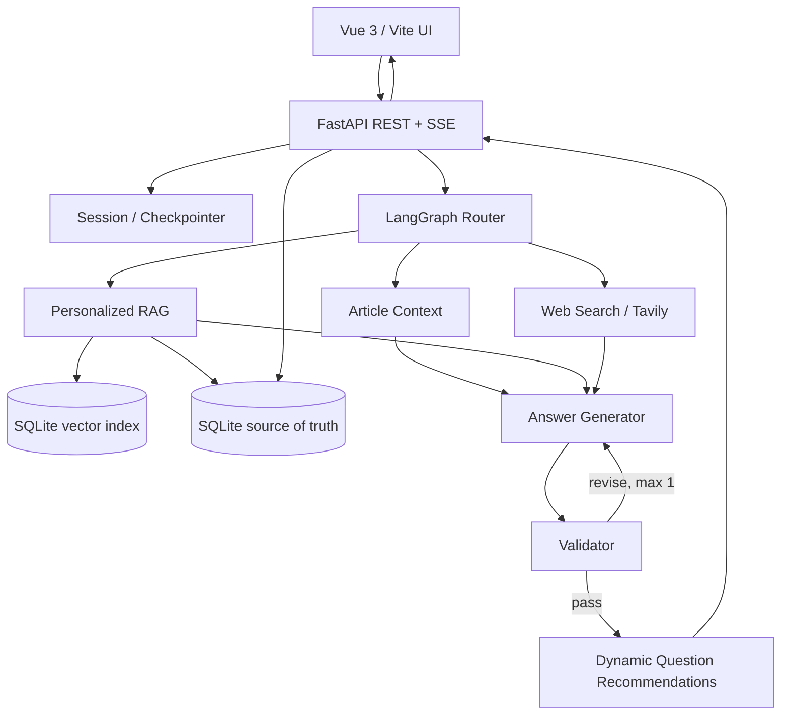

# PharmaMate 3.0 개발 계획서

> - **프로젝트:** Personalized AI Learning Agent for Pharma & Biotech
> - **과제 유형:** 2번 — Base AI Agent와 주제가 다른 제약·바이오 학습 AI Agent 개발 (기존 PharmaMate 2.2를 기준선으로 활용)
> - **기준 프로젝트:** [skala-ai-service-pharmamate](https://github.com/dyoungleee/skala-ai-service-pharmamate) (PharmaMate 2.2)
> - **현행 환경:** Jupyter Notebook / Gradio / LangGraph / OpenAI / SQLite
> - **목표 환경:** 모듈형 Python Agent / 개인 학습 RAG / 답변 검증; 이후 FastAPI / SSE / Vue / Ollama 확대
> - **작성일:** 2026-10-20

## 1. 프로젝트 개요

### 1.1 배경

기존 PharmaMate는 제약·바이오 기사 URL/본문 분석, 핵심 용어 추출, LangGraph 기반 질문 라우팅, Tavily 웹 검색, SQLite 학습 기록, Gradio UI를 제공한다. 현재 핵심 코드는 `PharmaMate_2_0.ipynb`에 집중되어 있다.

### 1.2 고도화 목표

- **개인화 학습:** 과거 메모·Q&A를 의미 검색(RAG)해 현재 학습과 연결한다.
- **신뢰성:** 생성 답변의 주장과 기사·학습 기록·검색 결과의 근거 일치를 검증한다.
- **초보자 학습 지원:** 직전 질문과 답변을 반영해 학습 목적이 다른 후속 질문을 추천한다.
- **기록 정합성:** 동일 기사 중복 저장을 방지하고, 같은 산업 사건을 다룬 여러 기사를 하나의 이슈로 연결한다.
- **서비스화:** Notebook 중심 코드를 모듈화하고 Vue/FastAPI로 분리하며 세션·오류 처리·스트리밍을 제공한다.
- **실증적 설계:** Query Routing, Dynamic Planning, MCP, 병렬 처리는 기존 방식과 비교한 뒤 채택한다.

### 1.3 범위 원칙

실험 후보 기술을 모두 적용하는 것이 목표는 아니다. 제출 전에는 **동작하는 핵심 기능과 동일 조건의 실측 비교**를 우선하고, 서비스 UI 전환과 추가 오케스트레이션은 후속 범위로 둔다. 실험 결과가 불리하면 도입하지 않고 ADR에 근거를 남긴다. Ollama는 우선 검토하되 현행 버전이 OpenAI를 사용하므로, 모델을 바꾼 결과를 아키텍처 개선 효과로 해석하지 않는다.

## 2. 현행(AS-IS) 및 목표(TO-BE)

| 영역 | 현행 구조 및 확인된 한계 | 구현 방안 | 목표 변화 | 검증 방법 |
|---|---|---|---|---|
| 개인 학습 검색 | SQLite `search_study_memory` 기반. 다른 표현의 유사 개념 검색 품질은 미검증 | SQLite `memory_embeddings` 파생 인덱스에 임베딩 JSON 저장, cosine+단어 점수로 검색하고 원문 기록 ID 연결 | 표현이 달라도 기존 학습 기록 검색, 임베딩 장애 시 단어 검색으로 복구 | Recall@3, MRR, 검색 지연시간 |
| 답변 검증 | 기사/기록/웹 출처 구분은 있으나 주장별 검증 노드 없음 | LangGraph Validator, 근거 불일치 탐지, 재생성 최대 1회 | 기사에 없는 임상 수치를 임의로 단정하지 않음 | 근거 일치율, 불근거 주장 비율, 지연/토큰 |
| 실시간 응답 | Gradio 중심 응답 표시 | FastAPI SSE + Vue 스트림 소비 | 답변 생성 중 텍스트/진행 상태 점진 표시 | 첫 응답시간(TTFT), 오류 복구 |
| 코드 구조 | Notebook 중심 구현 | 기사·Agent·RAG·DB·API 계층 모듈화 | 기능별 테스트 및 서버 독립 실행 | 단위/통합 테스트 |
| 장애 처리 | URL 추출 실패 시 붙여넣기 대안 존재; 외부 도구 장애 복구 검증 필요 | 타임아웃, 제한적 재시도, fallback, 오류 코드 | Tavily 실패 시 최신 정보 미확인 안내 | 오류 주입 테스트 |
| 세션 | Gradio 상태와 로컬 DB 중심 | 세션 ID, DB 기반 체크포인트, 사용자별 데이터 범위 | 재접속 시 저장된 대화 복원 | 재시작/세션 격리 테스트 |
| 후속 질문 | `recommended_questions(term_name)` 기반 추천 | 직전 Q&A·현재 용어·학습 이력 반영한 구조화 추천 | “왜 항체를 써?” 답변 후 표적·비교·한계 질문 추천 | 관련성/다양성 평가 |
| 기사/이슈 중복 | URL 또는 정규화 제목 기준 중복 기사 저장 방지 이미 존재 | URL/본문 해시, 유사도 및 사건 식별 | 다른 제목의 같은 기사 감지; 다른 기사는 보존하고 동일 이슈로 묶기 | 중복 탐지 precision/recall |
| 설계 근거 | 기술 선택 기록 체계 없음 | ADR 문서 | 도입/보류 이유 및 트레이드오프 추적 | ADR 작성 여부 |

> **중요:** 위 문제 중 성능 저하·오탐은 확정된 결함이 아니라 **검증할 가설**이다. 기존 기능(라우팅, 기사 중복 방지 등)은 신규 도입으로 표현하지 않는다.

## 3. 신규 도입 기능 상세

### 3.1 Personalized RAG

- **데이터:** SQLite의 용어, 학습 메모, 관련 Q&A 및 기사 맥락.
- **인덱싱:** SQLite `memory_embeddings`에 청크·원본 기록 ID·콘텐츠 해시·임베딩 모델·임베딩 JSON을 저장한다. 원본 SQLite 기록을 기준으로 인덱스를 재구축할 수 있고, 변경된 청크만 다시 임베딩한다.
- **검색:** 질문 임베딩 → cosine 유사도와 단어 일치 혼합 점수 → top-k 후보 → 원본 기록 ID와 출처 메타데이터를 Agent에 전달한다. 임베딩 API 실패 시 기존 SQLite 단어 검색으로 대체한다.
- **정합성:** SQLite를 원본 저장소(source of truth)와 파생 벡터 인덱스 저장소로 함께 사용한다. 현재 단일 사용자 `local` 범위만 허용하고 세션별 소유권은 F7에서 연결한다. 선택 근거는 ADR-002에 기록한다.
- **완료 기준:** 표현이 다른 유사 질문으로 과거 기록 검색, 인용된 원본 기록 조회, 타 사용자 기록 누출 방지.

### 3.2 Answer Validator

- **입력:** 생성 답변, 근거 문서 및 출처 메타데이터.
- **검사:** 수치·날짜·임상 단계·회사명 등 검증 가능한 주장과 근거의 일치 여부.
- **처리:** `pass` / `revise` / `insufficient_evidence` 구조화 결과. 출처에 없는 수치·날짜를 결정적으로 확인하고, 평가 목적과 실제 임상 결과를 분리한다. 수정 최대 1회 후에도 실패하면 근거 부족을 표시한다. Validator 호출 장애도 보수적인 안내로 종료한다.
- **주의:** LLM 기반 판정도 오판 가능. 웹 검색 결과의 신뢰성을 자동으로 보증하지 않음. 합성 판정 사례와 재시도 한도는 F3 실험 보고서에 기록한다.
- **완료 기준:** 근거 없는 임상 수치 질문에 확인 불가 답변, 무한 재시도 없음.

### 3.3 SSE Streaming (3.0 확장)

- **API:** `POST /api/chat/stream`에서 `text/event-stream` 응답.
- **이벤트:** `status`, `token`, `sources`, `recommendations`, `done`, `error`.
- **UX:** Vue에서 단계 진행, 토큰 표시, 취소/재시도 UI 제공.
- **완료 기준:** 생성 중 점진 출력, 연결 끊김 시 명시적 오류 처리.

### 3.4 핵심 모듈화 및 FastAPI 전환

- 과제 제출 범위에서는 기존 노트북의 기사 추출·분석, Agent 그래프, DB 로직을 독립 모듈로 이동하고 Gradio 화면에서 호출한다.
- 후속 범위에서 FastAPI를 붙이고 API 요청/응답에 Pydantic 스키마를 사용한다.
- Vue는 UI 상태를 관리하고 AI 호출·키 관리는 서버에서만 수행.
- 기존 Gradio 화면은 회귀 확인용으로 보존 가능.

### 3.5 Error Handling

- URL 검증, 기사 추출 실패, Ollama 연결 실패, Tavily 타임아웃, JSON 스키마 실패, DB 오류를 분류.
- 재시도는 일시적 장애에만 적용하고 횟수·백오프 상한 설정.
- 최신 정보 조회 실패 시 검색하지 못한 사실을 명시하고 오래된 지식을 최신 사실로 제시하지 않음.
- 로깅 시 API 키와 개인 학습 기록 원문 노출 최소화.

### 3.6 Stateless Session (3.0 확장)

- API 서버 프로세스 메모리에만 대화 상태를 보관하지 않음.
- `session_id`와 영속 저장소를 연결하여 재접속/재시작 시 복원.
- **범위:** 초기에는 익명 세션 기반. 인증 없는 세션 ID만으로 다른 사용자의 기록에 접근할 수 없도록 접근 제어를 설계하고, 외부 공개 배포 시 인증 도입 필요.
- SQLite와 LangGraph 체크포인터 활용 가능. 요청 간 상태 일관성과 중복 저장 테스트.

### 3.7 ADR

`docs/adr/`에 각 결정의 Context / Alternatives / Decision / Consequences / Evidence 기록.

- ADR-001: Vue + FastAPI로 분리하는 이유
- ADR-002: SQLite + Vector DB 병행 선택
- ADR-003: 현행 OpenAI 기준선과 Ollama 도입 판단
- ADR-004: Validator 도입과 지연·비용 트레이드오프
- ADR-005~008: Routing / Planning / MCP / 병렬 실행 실험 후 채택·보류 결정

## 4. 사용자 기능 개선

### 4.1 맥락 기반 동적 추천 질문

**사용 시나리오:** 사용자가 ADC에 대해 “왜 항체를 사용해?”라고 질문하고 답변을 읽은 직후, 추천 질문이 초기 정의 중심에서 표적 항원·일반 항암제 비교·부작용 탐구로 갱신된다.

- **입력:** 현재 용어, 직전 사용자 질문, 직전 AI 답변, 최근 관련 Q&A, 저장된 학습 메모.
- **출력:** 3개 추천 질문과 `category`, `question`, `learning_goal` 필드.
- **추천 범주:** 원리 심화 / 다른 개념과 연결 / 한계·응용 탐구.
- **규칙:** 이미 답한 질문 반복 방지, 초보자 수준의 표현, 질문 클릭 시 채팅 입력창에 삽입.
- **최적화 후보:** 답변과 함께 생성 vs 별도 추천 노드 호출(품질·지연 비교).
- **완료 기준:** 직전 질문이 바뀌면 후속 질문도 관련성 있게 변경되고, 각 질문에 학습 목적이 표시됨.

### 4.2 기사 및 산업 이슈 중복 관리

- **1차:** 정규화 URL, 본문 해시로 완전 동일 기사 탐지.
- **2차:** 제목·본문 유사도로 동일 기사 후보 탐지. 오탐 가능성이 있으면 사용자 확인.
- **3차:** 서로 다른 기사가 동일 사건(회사·약물·임상 단계·발표 이벤트)을 다루는 경우 별도 기사로 보존하되 하나의 산업 이슈에 연결.
- **주의:** 동일 약물의 임상 2상과 3상 결과를 같은 사건으로 병합하지 않음.
- **데이터 모델 예시:** `articles`, `industry_issues`, `article_issue_links` (다대다 관계), 기사 고유 키/중복 상태.
- **완료 기준:** 같은 URL 재등록 방지, 제목만 다른 동일 본문 중복 탐지, 같은 이슈의 다른 기사 연결, 서로 다른 사건 오병합 방지.

## 5. 실험 후 선택적 도입할 기술

**기록·발표 원칙:** 동일 입력의 Before/After 실측 비교는 GitHub `README.md`에 실험 조건·원자료·해석을 기록한다. 발표 PPT에도 핵심 전후 수치를 한 장으로 요약한다. 과제 PDF의 발표 평가 기준은 문제 → 개발·개선 내용 → 전후 수치 → 한계 및 추가 개선 순서다.

**실험 원칙:** 같은 평가셋·동일 모델 및 버전·동일 하드웨어·동일 검색 데이터·동일 생성 파라미터에서 기존/후보 방식을 비교한다. 기본 비교는 현행 모델을 양쪽에 동일하게 사용한다. Ollama 비교가 필요하면 먼저 기존 흐름도 같은 Ollama 모델로 실행할 수 있게 한 뒤 구조만 바꿔 비교한다. 워밍업 후 반복 측정하며 품질과 자원 사용을 함께 기록한다.

| 후보 | 대조군 | 실험군 | 질문/시나리오 | 측정 지표 | 판단 기준 |
|---|---|---|---|---|---|
| Query Routing | 기존 `agent_router` | 질문 유형 세분화 Router | 기사·메모·최신 웹·복합 질문 | 올바른 경로 비율, 최종 답변 품질, 호출/토큰/지연 | 품질 유지 또는 개선과 비용/지연 이점이 확인되면 채택 |
| Dynamic Planning | 기존 조건부 그래프 | 복합 질문만 Planner 사용 | 최신 임상 결과+기존 학습 비교 | 작업 완수율, 근거 정확도, 호출/토큰/지연 | 복합 질문에서 유의미한 완수율 향상 시 제한 도입 |
| MCP Server | Python 함수 직접 호출 | 동일 기능 MCP Tool 호출 | 학습 기록 조회, 기사 검색 | 도구 성공률, 호출 지연, 재사용 가능성 | 재사용·표준화 가치가 운영 복잡도보다 클 때 채택 |
| 동시 실행 | 순차적 독립 작업 | AsyncIO/병렬 LangGraph 분기 | 기사 분석+학습 기록 조회 | 총 지연, 실패율, CPU/RAM 사용 | 동일 결과 품질에서 실측 지연 감소 시 채택 |

### 5.1 측정 절차

1. 대표 질문 20~30개를 정의하고 유형별로 정답 출처 또는 기대 동작을 라벨링한다.
2. 동일한 모델·버전·파라미터로 대조군·실험군을 실행한다(가능하면 각 질문 3회 반복). Ollama를 사용하면 2.2 기준선도 동일 Ollama 모델에서 실행한다.
3. 응답 품질(정확성·근거성·작업 완수), p50/p95 지연시간, 첫 토큰 지연, 토큰 수, 도구 실패율을 기록한다.
4. `python eval/compare_answers.py --case-id RAG-01 --demo`로 비교 화면을 먼저 확인하고, 실제 실행은 `python eval/compare_answers.py --case-id RAG-01 --baseline-ref HEAD` 또는 `--all`로 수행한다. 기능 개발 직전의 승인된 커밋을 기준선으로 쓰고, 작업 트리의 후보 구현과 같은 평가 입력으로 비교한다. 콘솔에는 답변, 출처, 라우트/검증 결과, 응답 시간을 표시한다. 사용 가능한 경우 토큰과 비용도 표시한다.
5. 실행 조건·원자료 요약·측정값·해석·한계를 `docs/experiments/`의 기능별 보고서에 기록하고, 결론과 핵심 수치는 ADR 및 README 보고서에 연결한다. 핵심 전후 수치와 해석은 PPT에도 요약한다. 결과가 불리하면 **미도입**으로 결론 내린다.
6. Ollama와 OpenAI 간 비교는 별도로 수행한다. 서로 다른 모델의 전후 수치를 구조 개선 효과라고 주장하지 않는다.

### 5.2 최소 평가셋 예시

| 유형 | 예시 질문 | 기대 결과 |
|---|---|---|
| 용어 정의 | “ADC가 뭐야?” | 기사 맥락과 용어 설명 |
| 의미 검색 | “전에 공부한 항체에 약물을 붙이는 기술 알려줘” | ADC 학습 기록 검색 |
| 최신 정보 | “최근 이 약물의 임상 결과가 발표됐어?” | 웹 근거 또는 확인 불가 안내 |
| 복합 질문 | “이번 기사와 이전 ADC 학습 내용 비교해줘” | 두 출처 연결 |
| 환각 방지 | “기사에 없는 임상 성공률을 알려줘” | 수치 조작 없이 근거 부족 표시 |
| 추천 질문 | “왜 ADC에 항체를 사용해?” | 답변 후 표적·비교·한계 질문 갱신 |
| 중복 관리 | 동일 본문을 다른 URL로 등록 | 중복 탐지 및 이슈 연결 규칙 적용 |

### 5.3 터미널 답변 비교 도구

- **실행:** 화면 점검은 `python eval/compare_answers.py --case-id RAG-01 --demo`; 실제 비교는 `python eval/compare_answers.py --case-id RAG-01 --baseline-ref HEAD`; 전체 세트는 `--all` 옵션으로 실행한다.
- **출력:** 같은 질문에 대한 2.2 기준선 답변과 3.0 답변을 구역별로 출력하고, 검색 출처·라우트·Validator 판정·응답 시간을 함께 보여준다. 토큰/비용은 모델 제공자가 값을 돌려주는 경우 표시하고, 없으면 `미제공`으로 나타낸다.
- **공정 비교:** 한 번의 실행에서 같은 모델·버전·생성 설정·테스트 fixture를 두 실행기에 전달한다. 각 기능 시작 시 직전 승인 커밋을 `--baseline-ref`로 지정해 기준선이 후보 코드와 함께 바뀌지 않게 한다. 후보가 노트북이 아닌 모듈이면 `--candidate-runner package.module:function`으로 실행기를 지정한다.
- **데이터 보호:** 운영 중인 `pharmamate.sqlite3`를 수정하거나 개인 학습 기록을 출력하지 않는다. 샘플 평가 데이터만 사용하고, 원문 답변 로그는 기본적으로 로컬에만 저장한다.
- **반복 실행:** `--all` 결과는 요약표와 JSONL로 저장해 README/PPT에 사용할 수 있다. 생성 결과 파일은 Git에 올리지 않고 측정 조건·집계 수치만 보고서에 기록한다.
- **완료 기준:** 단일 사례와 전체 세트를 터미널에서 실행할 수 있고, 같은 입력의 전후 답변과 지표를 재현한다.

## 6. 시스템 아키텍처



> 위 도식은 **3.0 목표 아키텍처**다. 과제 제출 시점에는 기존 Gradio 화면을 사용해도 되며, FastAPI·Vue·SSE는 단계적으로 연결한다. Planner/MCP/병렬 분기는 실험 후 채택 시 추가한다. Validator 재시도 횟수는 상태에 저장해 순환을 제한한다.

## 7. 제안 폴더 구조

```text
pharmamate/
├── frontend/                  # Vue 3 + Vite
│   └── src/
│       ├── components/        # 기사 뷰어, 채팅, 추천 질문
│       ├── views/             # 기사 학습, 학습 기록, 산업 이슈
│       └── services/          # REST / SSE 클라이언트
├── backend/
│   ├── app/
│   │   ├── main.py            # FastAPI 엔트리포인트
│   │   ├── api/               # articles, chat, records, issues
│   │   ├── agents/            # graph, router, answer, validator
│   │   ├── services/          # 기사 추출, 추천 질문, 중복 판정
│   │   ├── retrieval/         # embeddings, vector index, retrieval
│   │   ├── db/                # SQLite 스키마, repositories
│   │   ├── schemas/           # Pydantic 요청/응답
│   │   └── core/              # config, logging, exceptions
│   └── tests/
├── eval/                      # 평가셋, 실험 실행, 결과
├── docs/
│   └── adr/
├── legacy/
│   └── PharmaMate_2_0.ipynb  # 기존 코드 보존
└── README.md
```

## 8. API 초안

| Method | Endpoint | 역할 |
|---|---|---|
| POST | `/api/articles/analyze` | 기사 URL/본문 분석 |
| POST | `/api/chat/stream` | Agent 답변·출처·추천 질문 SSE |
| GET | `/api/sessions/{session_id}` | 저장된 대화 상태 조회 |
| GET | `/api/study-records` | 학습 기록 목록 |
| POST | `/api/study-records` | 검토된 학습 메모 저장 |
| POST | `/api/articles/mark-read` | 기사 읽기 완료 및 중복 검사 |
| GET | `/api/industry-issues` | 중복 정리된 산업 이슈 목록 |
| POST | `/api/sessions/{session_id}/articles/mark-read` | 세션별 기사 중복 판정 및 이슈 연결 |
| GET | `/api/sessions/{session_id}/industry-issues` | 세션별 산업 이슈와 기사 묶음 |

API 경로는 구현 중 조정 가능하며, 세션·기록 접근 권한 검증이 필요하다.

## 9. Vue UI/UX 계획

1. **기사 학습 화면:** URL/본문 입력, 기사 요약, 원문 하이라이트, 용어 카드.
2. **AI 학습 채팅:** SSE 답변 스트리밍, 참조 출처, 근거 부족 표시, 질문 추천 카드 3개.
3. **내 학습 기록:** 용어·메모·Q&A 검색, 이전 학습과 현재 기사 연결.
4. **읽은 기사 / 산업 이슈:** 기사 중복 안내, 동일 사건 기사 묶음, 읽기 기록.
5. **실험·진단 화면(개발자용, 선택):** 모델, 실행시간, 호출 경로, 검증 결과 표시.


## 10. 구현 순서와 Git 푸시 단위

### 10.1 과제 제출 범위 (Day3 14시 전)

| 순서 | 구현 단위와 산출물 | 완료 확인 | 커밋 예시 |
|---|---|---|---|
| F0. 기준선·터미널 비교 | 기준선 노트북과 작업 트리 후보를 연결한 `eval/compare_answers.py`, 샘플 평가 데이터 `eval/cases.jsonl` | `--demo`로 화면 확인, 실제 모드에서는 같은 입력의 두 답변·출처·검증 결과·응답 시간을 출력. 개인 DB를 건드리지 않는 fixture 사용 | `chore(eval): add answer comparison CLI` |
| F1.1 Agent 그래프 모듈화 | LangGraph Router·Memory·Web·Answer를 `backend/app/agents/graph.py`로 옮기고 노트북에서 의존성을 주입 | Gradio Agent 질문 흐름이 유지되고 기준선 대비 오류가 없음 | `refactor(agent): extract graph module` |
| F1.2 나머지 코어 모듈화 | 설정을 `core/config.py`, SQLite 저장소를 `db/repository.py`, 기사 본문 추출을 `services/article_extraction.py`로 옮기고 노트북·Gradio 호출부 연결 | 격리된 임시 DB에서 기사·용어·학습 메모 저장/조회 검증, 기존 질문 흐름은 답변 비교 도구로 회귀 확인 | `refactor(core): extract article and db modules` |
| F2. 개인 학습 RAG | SQLite 기록에서 재구축 가능한 인덱스를 만들고 원본 기록 ID와 함께 검색 | 다른 표현의 질문에서 관련 기록이 검색되고 기록 범위를 벗어나지 않음. Recall@3·지연 측정 | `feat(rag): retrieve study history` |
| F3. 답변 검증 | 답변의 수치·날짜·임상 주장과 출처를 검사하고 수정 1회 상한을 적용 | 근거 없는 수치를 확정하지 않으며 실패 시 근거 부족을 표시. 근거 일치율·지연 측정 | `feat(agent): validate answer evidence` |
| F4. 평가·제출 | 같은 입력의 전후 결과, ADR, 실행법을 README에 기록하고 PPT에 핵심 수치와 한계를 요약 | Git 주소·결과 보고서 주소 등록, 주요 기능 시연 가능 | `docs(report): publish measured results` |

**시간이 부족할 때:** F0~F3의 실제 작동과 F4의 재현 가능한 증거를 우선한다. 새 모델로의 교체, 새 프런트엔드, 다수의 선택 기술을 한꺼번에 도입하지 않는다. Day3 17시 30분 발표 전에는 시연 흐름과 PPT를 확인한다.

**완료·푸시 기록:** F0 `904797c`, F1.1 `dd0bc50`, F1.2 `c7469ff`, F2 `be9a865`, F3 `e58790e` 및 Validator 개선 `3114e86`, F4 `dc9acd8`, F5 `65d3089`, F6.1 `15fd0f6`, F6.2 `b72299d`, F6.3 `444cb7e`, F6.4 SSE 오류 복구·브라우저 E2E `895ab54`, F7.1 `d620925` 및 프로세스 재시작 복원 검증 `c41c67a`, F7.2 `cdf7b5c`, F8.1 `324b067`. F8.2 Dynamic Planning은 추가 호출 비용이 품질 개선으로 이어지지 않아 보류한다. F8.3 MCP Server는 `8bf3673`, F8.4 병렬 source 실행은 `ff5e9f6`, F8.5 Ollama 호환성 평가·최종 PPT는 `e521866`에서 각각 구현·푸시했다. Ollama는 구조화 출력 호환성을 확인했지만 지연·라우팅 정확도 결과에 따라 도입을 보류한다. F8.1~F8.5의 조건·결과·한계는 `docs/experiments/`에 기능별로 기록한다. 종합 발표 자료는 [F8 결과 PPT](../outputs/PharmaMate_3.0_Implementation_Results_F8.pptx), F4 비교는 [F4 보고서](experiments/F4_overall_evaluation.md)에 남긴다.

### 10.2 3.0 후속 범위

1. **F5 — 동적 후속 질문 (완료):** 답변과 질문을 한 번의 구조화 출력으로 생성한다. 원리 심화·개념 연결·한계/응용 질문 3개와 학습 목표를 표시한다. 합성 입력 4건에서 별도 생성 방식과 지연·토큰·비용을 비교하고, 결과는 [F5 실험 보고서](experiments/F5_dynamic_followup_questions.md)에 기록했다.
2. **F6 — API와 화면 (F6.1~F6.4 구현):** FastAPI 기사/질문·학습 기록 API, 검증 답변 SSE, Vue 화면을 연결했다. 기사 분석 → 질문 → 출처·후속 질문 확인 → 검토한 학습 기록 저장 흐름을 제공한다. 백엔드 통합 테스트 37개, Vue production build, Chrome 합성 API 브라우저 E2E를 통과했다. 실제 OpenAI·Tavily를 연결한 외부 서비스 E2E는 수행하지 않았다. API 조건은 [F6.1 보고서](experiments/F6_1_fastapi_api.md), SSE 동작은 [F6.2 보고서](experiments/F6_2_sse_streaming.md), Vue 연결은 [F6.3 보고서](experiments/F6_3_vue_frontend.md), 브라우저 흐름과 오류 복구는 [F6.4 보고서](experiments/F6_4_browser_e2e.md)에 기록한다.
3. **F7 — 세션과 이슈:** F7.1 익명 세션 토큰, 대화·기사 복원, 세션 소유 학습 기록과 RAG 범위를 구현했다. 별도 Python 프로세스에서 같은 SQLite 파일을 다시 열어 토큰 인증 후 기사·대화 복원까지 확인했다. F7.2에서 세션 안의 기사 URL·본문·제목 중복 판정, 산업 이슈 자동·수동 연결 및 UI 목록을 추가했다. 기존 SQLite 테이블은 보존하고 새 테이블만 추가한다. 합성 기준 비교와 한계는 [F7.1 보고서](experiments/F7_1_sessions.md), [F7.2 보고서](experiments/F7_2_article_issue_management.md)에 있다.
4. **F8 — 선택 기술 (검토 완료):** 합성 질문 24개에서 개선된 Query Routing을 채택하고, MCP 및 memory/web 병렬 실행을 도입했다. Dynamic Planning과 Ollama는 각각 추가 비용과 낮은 라우팅 정확도·긴 지연으로 보류했다. 개별 결과와 결정 근거를 보고서·ADR로 남겼다.

### 10.3 기능별 완료·커밋·푸시 절차

각 기능은 완료 기준과 검증을 통과하면 기능별로 커밋·푸시한다. 실험 조건과 결과는 `docs/experiments/`에 남긴다.

1. 시작 전 `git status`와 원격 브랜치를 확인하고, 사용자가 따로 수정 중인 파일은 보존한다.
2. 구현 후 해당 기능의 완료 기준과 필요한 검증을 수행한다. 실패한 기능은 원인을 수정한 뒤 완료 처리한다.
3. 기준선/후보 비교와 필요한 실험을 실행하고, 실행 명령·결과·해석·한계를 기능별 문서에 기록한다. 비용이 드는 모델 호출은 합성 평가 자료만 사용하고 결과에 호출 조건을 적는다.
4. 해당 기능 파일만 명시적으로 스테이징한다. `.env`, `pharma/`, `pharmamate_data/`, 개인 기록, 모델 파일 및 `eval/results/` 생성 산출물이 포함되지 않는지 확인한다.
5. 기능 단위 메시지로 커밋하고 `git push origin main`을 실행한다. 푸시 후 원격 HEAD를 확인하고 완료 보고에 커밋 해시, 푸시 결과, 실험 보고서 링크, 검증 결과와 남은 제한을 적는다. 강제 푸시는 사용하지 않는다.

## 11. 완료 기준 (Definition of Done)

### 과제 제출 시점

- [x] `python eval/compare_answers.py --all --demo`로 기준선과 후보 답변을 터미널에서 확인할 수 있고, 실제 실행 모드도 구현했다. demo는 LLM을 호출하지 않는 고정 예시임을 출력한다.
- [x] 2.2 기준선과 동일 평가 질문을 보존하고 비교 조건을 문서화했다.
- [x] 기사 분석 → 질문 → 검토한 학습 기록 저장 흐름을 API 및 Vue에 구현했다.
- [x] 개인 학습 RAG가 원본 기록 ID를 연결하며 검색 품질과 지연을 측정했다.
- [x] Validator가 근거 부족을 표시하고 재작성 횟수를 제한한다.
- [x] 핵심 기능 검증 결과와 장애·트레이드오프를 README, 실험 보고서, ADR에 기록했다.
- [x] README와 PPT에 Before/After 수치, 실험 조건, 한계를 제시했다.
- [x] 제출 변경분을 GitHub `main`에 푸시했다. 저장소 및 보고서 주소는 README와 제출 안내에 등록한다.

### 3.0 확장 완료 시점

- [x] Vue에서 기사 입력 → 분석 → Agent 질문 → 후속 질문 입력 → 학습 기록 및 읽은 기사 저장 흐름을 구현했다. API 단위 테스트와 합성 API를 사용한 Chrome 브라우저 E2E로 검증했다.
- [x] SSE는 검증된 답변만 전송하고 API 오류·사용자 취소·명시적 SSE 오류·연결 무응답을 화면 오류로 처리한다. 무응답 제한에 도달하면 스트림을 중단하고 질문 입력을 다시 활성화한다.
- [x] 재접속·서버 프로세스 재시작 후 허가된 세션의 기사·대화를 복원할 수 있다. 별도 Python 프로세스의 SQLite 재연결 및 API 토큰 검증 테스트와 Vue production build를 통과했다.
- [x] 답변 직후 학습 목적이 다른 후속 질문 3개가 갱신된다.
- [x] 동일 기사 재등록을 막고, 서로 다른 기사가 같은 산업 이슈를 다루면 연결한다. 합성 5쌍 기준 중복 Recall 0.5→1.0, 이슈 연결 precision/recall 1.0/1.0; 표본 한계는 F7.2 보고서에 기록했다.
- [x] Ollama 구조화 출력 smoke, 24개 라우팅 비교, 선택 기술의 채택·보류 이유를 실측 및 ADR로 설명한다.

## 12. 위험 및 트레이드오프

| 위험 | 영향 | 대응 |
|---|---|---|
| Ollama 로컬 모델의 구조화 출력/도구 호출 불안정 | Agent 라우팅·검증 실패 | Pydantic 검증, 재시도 상한, 모델별 기능 테스트 |
| RAG 임베딩/검색 지연 | 응답시간 증가 | 인덱스 사전 구축, 캐시, top-k 제한 |
| Validator 추가 호출 | 토큰/지연 증가 | 검증 범위 최적화, 재생성 최대 1회 |
| 의미 기반 중복 판정 오탐 | 서로 다른 임상 사건 병합 | 정확 일치 우선, 사건 속성 비교, 사용자 확인 |
| 세션 ID 노출 | 다른 사용자 기록 접근 위험 | 안전한 토큰, 소유권 검사, 외부 배포 시 인증 |
| Vue/FastAPI 전환 작업량 | 핵심 AI 기능 구현 지연 | 기존 로직을 독립 모듈로 이식하고 API 통합 테스트 수행 |

## 13. README 보고서 및 발표 구성

과제 PDF 13쪽의 기본 배점은 기능 구현 완성도 30점, 기술 요소 반영 30점, 한계·트레이드오프 20점, 발표 20점이며, 같은 입력의 Before/After 실측 비교는 보너스 10점이다. 평가표는 발표에 전후 수치를 포함하도록 명시한다. Multi-Agent, MCP, RAG, 의존성 주입, LangSmith, 모듈화, 단위 테스트는 기술 요소의 예시이므로 필요한 기술을 선택하고 구현 근거를 제시한다.

### 13.1 GitHub README.md — 개발 결과 보고서

1. 프로젝트 소개와 해결하려는 사용자 문제
2. 기존 구현과 신규 구현의 범위, 주요 사용자 시나리오
3. 시스템 아키텍처, 사용 기술, 로컬 실행 방법
4. 동일 입력의 **Before/After 실측 비교**: 데이터셋, 모델·파라미터·하드웨어, 반복 횟수, 답변 품질·검색 적중률·토큰·지연시간 결과표
5. 오류 처리, 비용·지연·오탐 등 트레이드오프와 향후 개선
6. ADR과 평가 자료 링크

측정하지 않은 값은 임의로 채우지 않고 **미측정** 또는 **실험 예정**으로 표기한다. 모델 교체 비교는 구조 변경 비교와 별도로 표시한다.

### 13.2 발표 PPT 및 시연

PDF 평가 기준에 맞춰 다음 순서로 구성한다.

1. 제약·바이오 기사 학습의 문제와 기존 2.2 흐름
2. 새로 개발한 기능과 적용 기술을 보여주는 구조도
3. 기사 질문 → 개인 기록 검색 → 근거 검증의 실제 동작 시연
4. **동일 질문의 Before/After 핵심 수치 한 장**: 품질과 지연·비용의 변화, 측정 조건
5. 새로 생긴 한계·트레이드오프와 추가 개선 사항

**제출 준비:** GitHub 주소, Google Spread 결과 보고서 주소, 발표 PPT. 등록 방식과 마감은 배포된 과제 안내 및 담당자 공지를 따른다.

## 14. 참고 및 확인 필요 사항

- **기존 구현 확인 근거:** 저장소 README 및 `PharmaMate_2_0.ipynb` 구조.
- **과제 평가 기준:** 사용자 제공 「AI 서비스 개발 Mini-project」 PDF.
- **추가 확인:** 기존 개인 프로젝트를 활용한 신규 주제 Agent가 과제 2번으로 인정되는지와 로컬 LLM 사용 의무 범위. 계획은 PDF의 공통 평가표를 적용해 작성했다.
- **환경 확인:** 개발 장비 RAM/GPU 및 Ollama 모델 실행 가능 여부.
- **실험 수치는 아직 없음:** 모든 개선 효과는 실제 테스트로 검증해야 한다.
